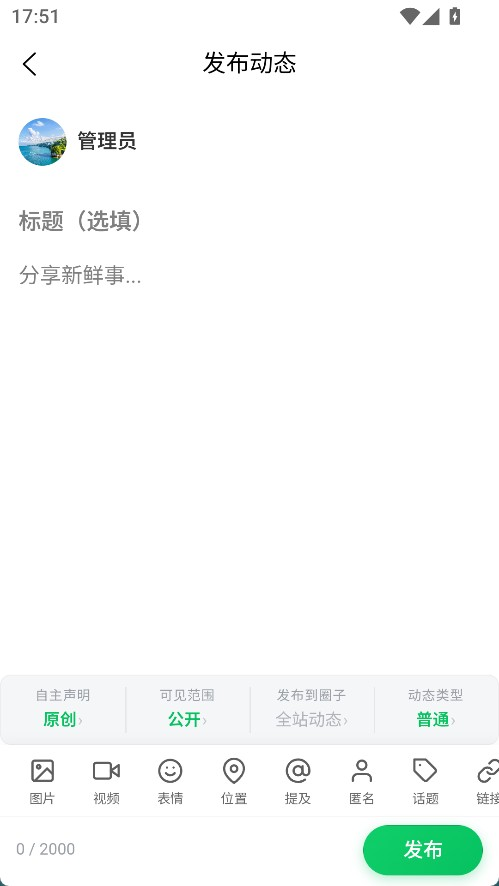
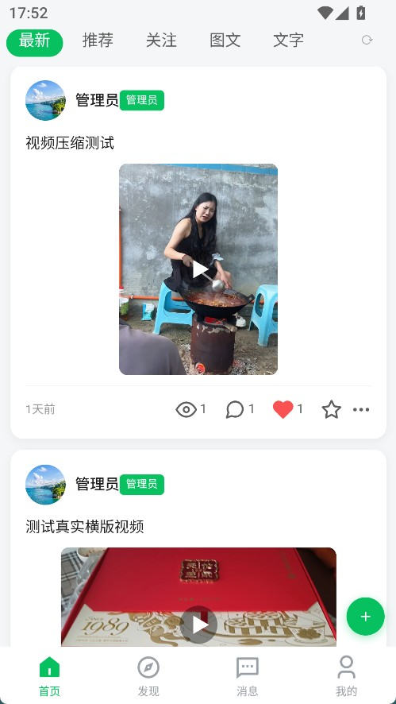
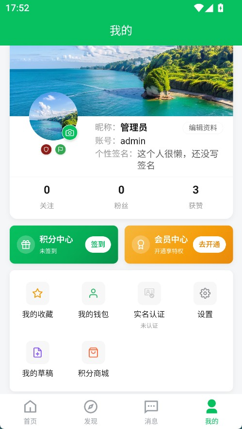

# 我圈

> 我圈，全称「我圈轻量可模板化的多形态内容社区系统」，简称「我圈」。


- **官网**：<https://woquan.com.cn>
- **Gitee 仓库**：<https://gitee.com/aiwoquan/woquan>
- **在线文档**：<https://yuechou.com.cn/guide/>（持续补充中）

## 项目简介

我圈是一套轻量、可模板化的多形态内容社区系统。同一套程序，通过站点模式、功能模块与主题，可搭建出不同类型的站点；付费兴趣社群与内容付费两套变现能力已内置，共用钱包、积分、会员与订单体系。

- **兴趣社区 / 私域**：圈子 + 动态信息流 + 私信 + 活动，可开付费圈子做订阅制社群。
- **博客 / 企业内刊**：文章内容流 + 话题 / 精华，可按篇或按专栏收费。
- **资讯站**：文章型内容流 + 话题运营，资讯主题带首屏 SEO 优化。
- **知识付费**：文章与专栏付费阅读，配合会员、钱包与积分体系。

## 站点形态

| 模式 | 定位 | 典型主题 | 核心能力 |
| --- | --- | --- | --- |
| `social` | 社交 / 兴趣社区 | moments | 动态、圈子、私信、活动、商业化 |
| `blog` | 博客 / 企业内刊 | zixunfeed | 文章、话题、精华、内容付费 |
| `news` | 资讯站 | zixunfeed | 文章、话题、精华、SEO |
| `content` | 内容付费 / 知识社区 | zixunfeed | 文章、内容付费、财务、会员 |
| `custom` | 自定义组合 | 任选 | 在预设基础上逐项开关 |

模块与预设在后台站点模式页配置。

## 效果展示

移动端 App 实机截图（Android；H5 同源）：

| 发布动态 | 首页信息流 | 我的 |
| :---: | :---: | :---: |
| <br>五种帖型、四档可见范围 | <br>多档切换、点赞 / 评论 / 收藏 / 转发 | <br>积分、会员、钱包入口 |

Web 端提供 `moments`（兴趣社区）与 `zixunfeed`（资讯 / 博客）两套主题，可在后台切换。

## 核心特性

- **动态信息流**：五种帖型、多档聚合、自动识别话题，支持点赞 / 评论 / 收藏 / 转发 / @提及。
- **圈子与付费社群**：圈主 / 管理员 / 成员分权，付费圈子支持包月 / 季 / 年订阅与到期清退。
- **内容付费**：单篇买断 + 专栏订阅，余额与积分抵扣，未购买用户仅见试读。
- **私信**：单聊 / 群聊、已读回执、消息撤回，图片压缩与视频转码，支持语音 / 视频通话。
- **活动与账号治理**：报名制活动、实名认证（姓名脱敏）、账号注销匿名化、敏感词三档过滤。
- **主题与商业化**：后台切换站点外观，会员 / 钱包 / 积分 / 在线充值，支持本地与主流云存储。

## 技术栈

| 层 | 技术 |
| ---- | ---- |
| 后端 | PHP >= 8.0 |
| 数据库 | MySQL >= 5.7 |
| 网站前端 | 原生 HTML / CSS / JavaScript |
| 管理后台 | 单页管理界面，无需构建 |
| 移动端 | uni-app，产出 Android / iOS / H5 |
| 可选依赖 | FFmpeg（视频转码）、Redis（缓存加速）、Ollama（本地 AI） |

## 环境要求

- **PHP** >= 8.0（推荐 8.1）
- **MySQL** >= 5.7
- 必需扩展：`PDO`、`PDO_MySQL`、`GD`、`JSON`、`cURL`（推荐 `Fileinfo`、`Redis`）
- Web 服务器：Apache（自带 `.htaccess`）或 Nginx（复制 `nginx.conf`）
- 可选依赖：`FFmpeg`（视频转码）、`Ollama`（本地 AI）

## 快速开始

```bash
# 1. 克隆仓库到网站根目录
git clone https://gitee.com/aiwoquan/woquan.git && cd woquan

# 2. 复制示例配置，填入真实数据库信息并重新生成随机 JWT_SECRET
cp config.example.php config.php

# 3. 确保可写目录
chmod -R 755 uploads/ cache/ logs/

# 4. 浏览器访问 http://你的域名/install.php 完成安装向导
#    向导会自动建表并写入默认配置，无需手工导入 SQL
```

安装后在后台选择站点模式与外观，详见在线文档。

## 移动端 App

- 客户端为 uni-app 工程。**公开仓库仅发布 PHP 后端，不含客户端源码**。
- 构建 H5：`npm install && npm run build:h5`，产物拷到站点 `h5/` 目录；原生 App（Android / iOS）用 **HBuilderX** 调试与云打包。
- 更多说明详见在线文档。

## 安全说明

- 登录采用 Token 机制，Web 端以 httpOnly Cookie 下发，支持后台强制失效。
- 写请求做 CSRF 校验，接口按用户 / IP 限流；用户输入多层过滤，防 XSS 与 SQL 注入。
- 密码加密存储，上传文件做类型与内容校验。
- 内容付费权益保护：未购买仅返回试读，订单与购买权益有防重复保护。
- 漏洞报告与安全加固方式见 [SECURITY.md](SECURITY.md)。

## 贡献指南

Fork 本仓库、创建特性分支并发起 Pull Request；开发环境、必跑门禁与文档同步要求见 [CONTRIBUTING.md](CONTRIBUTING.md)。

## 开源协议与代码权属

本项目的授权分两层，互不冲突：

| 代码范围 | 授权 | 你可以做什么 |
| --- | --- | --- |
| 源自 Hublog 的上游代码 | [Apache License 2.0](LICENSE) | 自由使用、修改、再分发与商用，须保留 LICENSE 与原始版权声明 |
| 本项目新增及实质性改写的代码 | 保留所有权利 | 个人学习、研究与非商业使用不受限；**商业用途需另行取得书面许可** |

分层依据来自 Apache-2.0 第 4 条：分发者可对自己的修改附加不同许可条款，同时保留上游代码的原授权。逐文件判定以各文件头的「修改记录」标注与 git 提交历史为准，概要见 [NOTICE](NOTICE)，完整模块清单与判定依据见 [代码来源与授权边界](docs/代码来源与授权边界.md)。

对外品牌「我圈 / woquan」不属于上述任何一层授权，Apache-2.0 不授予商标权。欢迎 Star、Fork 和提交 Issue / PR。
